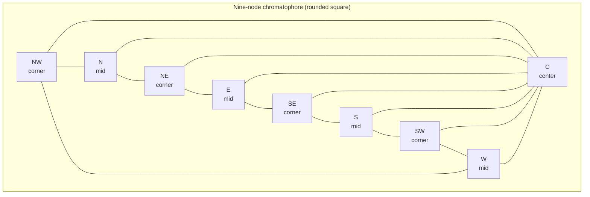

# Philosophy Chromatophore

Philosophy repository for the nonagon, octopus, chromatophore, and brain precedent framing.

The nine-node lattice is the fixed stamp. The chromatophore is the form that takes shape on that stamp. The octopus is the biological precedent for eight channels plus one head. The brain is the biological precedent for many channels converging on one integration point.

## Arrangement

- Four corners: NW, NE, SW, SE
- Four mid-edges: N, E, S, W
- One center: C

Rounded corners preferred. The shape stays fixed. The values change.

## Mermaid

## Precedent

The brain integrates distributed activity through thalamocortical loops, global workspace ignition, and rate-based binding. The lattice captures the same pattern: many channels feed one fusion point. The center is where local processing becomes accessible content.
